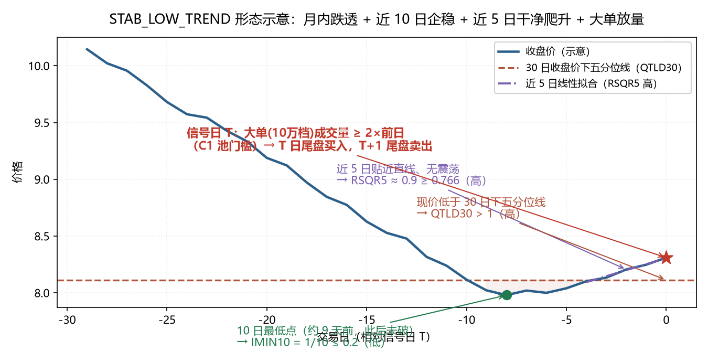
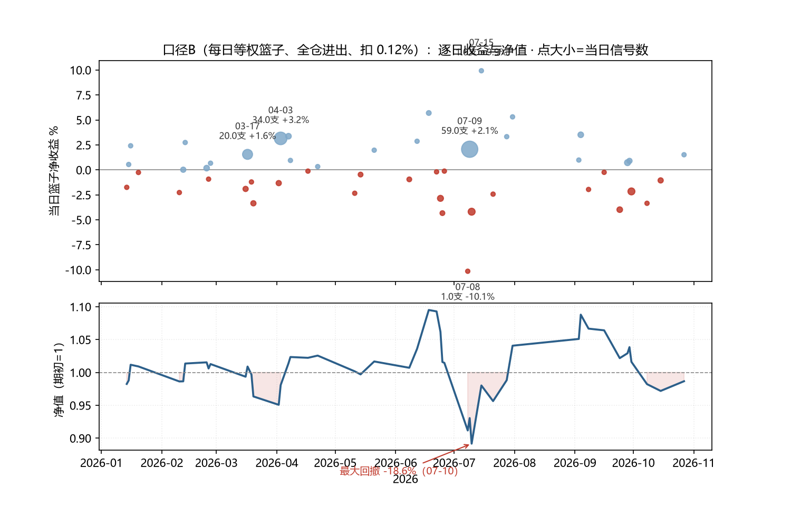

# STAB_LOW_TREND 信号定义卡（低位企稳趋势 × 大单阶跃）

> Date: 2026-11-04 · 线: `l2_signals` · PR #121 · 数据: core rollup + bigorder B 层 2026（湖修复后）
> 产出: [首轮搜索报告](2026-11-04-alpha158-joint-search.md) · 明细 `E:/stock_data/l2_research/signals/stab_low_trend_2026.csv`

## 一、信号速览

| 项 | 值 |
|---|---|
| 信号条件 | **IMIN10 ≤ q20 且 QTLD30 ≥ q80 且 RSQR5 ≥ q80** |
| 候选池（C1） | 大单（10 万档）成交量 ≥ 2×前日，且前日大单量 > 0；剔除一字/T 字板（KMID=0） |
| 池规模 | 83,612 股票日（2026-01-05 ~ 10-30），池内基线胜率 44~45%（阶跃本身轻微反指） |
| 触发次数 | **208 次**（H1 104 / H2 104，两半均衡） |
| T+1 胜率 | **70.7%**（H1 68.3% / H2 73.1%，两半同向） |
| 单次平均收益 | +1.07%（close-to-close，中位数 +1.49%） |
| 交易口径 | T 日尾盘竞价买入 → T+1 尾盘竞价卖出，持仓 1 个交易日 |
| 复现 | `D:/anaconda3/envs/vanna312/python.exe l2_signals/export_signal.py --signal STAB_LOW_TREND` |

## 二、q20 / q80：分位条件的含义

q = 分位数，刻度取自候选池全部 83,612 个股票日的因子取值。`≥q80` = 落在全池最高 20% 区间；`≤q20` = 最低 20% 区间。用分位而非绝对阈值是为了横截面可比（低价股与高价股、价格类与波动率类不可直接比）。**阈值仅用 H1（1-6 月）样本计算并冻结**，再原样应用于 H2（7-10 月），杜绝"用未来数据定门槛"的泄漏。

## 三、三个条件逐一拆解

### ① IMIN10 ≤ q20 —— 近 10 日不再创新低（止跌企稳）

```
IMIN10 = IdxMin($low, 10) / 10        本次切点：≤ 0.2
```

过去 10 日最低价出现的位置（1~10，1 基）÷ 10。值小（≤0.2）：最低点在 8、9 天前，此后未再跌破 → 止跌企稳；值大（→1.0）：最低点就是昨/今天 → 仍在创新低。

### ② QTLD30 ≥ q80 —— 价格仍处 30 日低位带（跌透了）

```
QTLD30 = Quantile($close, 30, 0.2) / $close     本次切点：≥ 1.00784
```

30 日收盘价下五分位线 ÷ 现价。切点 >1：现价低于"月内最便宜 20% 时候的价位"——比过去一个月约 80% 的时间都便宜。

### ③ RSQR5 ≥ q80 —— 近 5 日走势干净（安静爬升、不震荡）

```
RSQR5 = 5 日收盘价对时间线性回归的 R²      本次切点：≥ 0.766
```

最近 5 日收盘价贴近一条直线——小幅平稳爬升而非震荡。R² 只度量"直不直"，与①②组合后自然锁定"低位企稳后的缓慢爬升"。

## 四、形态示意图



*图 1 形态示意（示教用合成数据，非真实行情）：月内跌透 + 近 10 日企稳 + 近 5 日干净爬升 + 大单放量*

## 五、C1 池门槛：大单阶跃

信号只在"大单（单笔成交额 10 万档以上）成交量 ≥ 2×前一日"的股票日上触发，且前日大单量 > 0。池已剔除一字/T 字板（KMID=0，买方基本无法成交，会伪装出高胜率——首轮搜索即因此踩坑）。

## 六、组合逻辑与经济含义

三个条件合并：**月线级跌透（②）+ 近 10 日趴住不创新低（①）+ 近 5 日安静小爬（③），当天大单量翻倍 → T+1 上涨概率 70.7%**。经济逻辑：这是"大单资金在跌透企稳的冷门票里开始吸筹"的指纹——不是追涨停的激进买（已验证为反指），而是无人问津低位的温和介入。六信号族"安静吸筹 > 激进追涨"结论的 Alpha158 表达。

## 七、口径、假设与持有期

**持有期敏感性**（同一批 208 次，T 日收盘买入）：

| 持有至 | 平均收益 | 中位数 | 胜率 | 日均效率 | 扣 0.12% 成本后 |
|---|---|---|---|---|---|
| **T+1** | **+1.07%** | +1.49% | **70.7%** | **1.07%/日** | **+0.95%** |
| T+2 | +0.69% | 0.00% | 48.1% | 0.35%/日 | +0.57% |
| T+3 | +0.52% | +1.20% | 57.7% | 0.17%/日 | +0.40% |
| T+4 | +0.35% | +1.83% | 55.8% | 0.09%/日 | +0.23% |
| T+5 | +0.67% | +2.17% | 55.8% | 0.13%/日 | +0.55% |

收益集中在第一个隔夜；第 2 日为均值回归日（胜率 48.1%、中位数归零）。均值随持有期递减而中位数递增——久持时半数信号仍在缓慢上行，但少数大亏损拖低平均值。**T+1 卖出全方位最优。**

其他口径：close-to-close 未计滑点；双边成本约 0.10~0.15%；T+1 跌停卖出风险未建模（留 backtrader 成交核）；H1/H2 时间切分防过拟合；523 条件 × 13.5 万对扫描存在多重检验风险——**2025 跨年验证通过前不应视为可上线**。

## 八、2026 年累计：三口径与聚簇诊断

> 统计上真实（70.7%）≠ 交易上赚钱。本节按可实现性给出三个口径。

| 口径 | 假设 | 2026 累计（毛） | 扣 0.12%/次 |
|---|---|---|---|
| A 逐笔全仓连乘 | 208 笔逐一复利（**数学幻觉，不可实现**） | +733% | +551% |
| **B 每日等权篮子** | 同日信号等权一篮、全仓进出、无信号日空仓 | **+4.5%** | **-1.3%** |

口径 A 不可实现的原因即聚簇本身：208 笔集中在 **48 个交易日**（中位 1 支/天，最多 59 支/天），同日多笔无法连乘。口径 B 净值最大回撤 **-18.6%**。



*图 2 口径 B 逐日篮子净收益（点大小 = 当日信号数）与净值曲线*

### 聚簇诊断

**并发最多的 5 天（反而都是好日子）**：

| 日期 | 信号数 | 当日篮子 |
|---|---|---|
| 2026-07-09 | 59 支 | +2.19% |
| 2026-04-03 | 34 支 | +3.28% |
| 2026-03-17 | 20 支 | +1.68% |
| 2026-07-10 | 8 支 | -4.06% |
| 2026-09-30 | 8 支 | -2.03% |

**最差 5 个信号日（全是孤票日）**：

| 日期 | 信号数 | 篮子收益 |
|---|---|---|
| 2026-07-08 | 1 支 | **-10.02%** |
| 2026-06-25 | 2 支 | -4.21% |
| 2026-07-10 | 8 支 | -4.06% |
| 2026-09-24 | 4 支 | -3.86% |
| 2026-03-20 | 3 支 | -3.22% |

### 三个病因

1. **中位 1 支/天 → 全仓压单票**：2026-07-08 唯一 1 支信号次日 -10.02%（跌停级），一笔打掉账户 10%。单票尾部风险直通账户。
2. **波动拖累复利**：48 个活跃日篮子日均波动约 4%，几何收益 ≈ 算术 − σ²/2，48 天把 +1.07% 的算术优势磨到 +4.5% 毛收益，再被成本吃穿为 -1.3%。
3. **反差**：并发大日（市场情绪日）信号质量高（59 支 +2.19%、34 支 +3.28%）；伤账户的是冷清日的孤票。

### 结论与下一步

信号统计上真实，朴素执行不构成策略——**缺的不是选股，是组合层**：

- 单票仓位上限（如 ≤20%）+ 每日起做门槛（N<3 支放弃或减半仓）
- 市场状态过滤（避开篮子高波动普跌日）
- 止损 / 次日开盘出口敏感性

→ 进入 backtrader 向量化回测（三仓分工：本仓出信号，BT 做回测研究）。逐笔明细与分日聚簇画像已齐备，为回测直接输入。

## 八-B、引擎验证（MyQuant-backtrader 日线，stab_t1 书，2026-11-04）

> 池由 `l2_signals/export_bt_pool.py` 导出（YYYYMMDD.csv，文件名=买入日 T）；
> 书 = `stab_t1`（close_clear 钩子 T+1 收盘卖 + 日线 same-bar 成交，无止损，daily_quota 全仓等权，
> cash=daily_quota=2100 万）；分支 feat/stab-t1-book。

| 变体 | 费率 | 收益 | 最大回撤 | 买入 |
|---|---|---|---|---|
| V0 全量 48 日 | industry 真实 | **-8.07%** | **-24.4%** | 175/208 |
| V0 全量 | 10bp 研究双边 | -11.13% | -22.3% | 164/208 |
| **V1 N≥3 门槛 17 日** | industry 真实 | **-0.37%** | **-5.3%** | 148/173 |
| V1 N≥3 | 10bp 研究双边 | +1.04% | -5.4% | 144/173 |

**逐笔对账（研究口径 vs 引擎）的三个发现：**

1. **跌停延卖是真实尾部**：2026-07-08 孤票日研究口径 -10.02%，引擎 T+1 跌停顺延至次日开盘 → 实际 -13.1%（全仓单票日直接 -3pp 打在净值上）。研究口径 B 假设总能 T+1 收盘卖出，系统性低估尾部。
2. **整手取整的整笔跳过**：legacy 档现金不足整笔 skip 不缩量 → 单票日 2100 万无法整手买满被整笔跳过（44/208 未成交；industry 档 shrink → 33 未成交）。V1 中 10bp 档"反超"industry 1.4pp 即由此而来——恰好跳过 4 笔均值 -5% 的亏损交易，纯运气非设计；费率真相仍是 industry（~0.11% 往返）< 10bp 双边（0.2% 往返）。
3. **全仓日频周转的成本拖累**：每次往返 0.11~0.2% × 全仓 × 28 个买入日 ≈ 3~5.6pp——研究口径 +4.5% 毛收益在费率+执行现实下归零转负。

**引擎验证结论：**
- **N≥3 起做门槛处方成立**：回撤 -24.4% → -5.3%，收益 -8.1% → -0.4%（10bp 下 +1.0%），与聚簇诊断的预测一致。
- 即便如此，全仓日频 T+1 在真实费率下仍不赚钱——**下一步是限频/仓位分级（非全仓）、滑点敏感性、以及阶段二分钟线**（买 14:55 / 卖 15:00 的保真度升级，湖截至 2026-09-18）。
- 复现：`python backtest/research/csv_daily_backtest.py --strategy stab_t1 --pool-dir exports/stab_low_trend_* --start 20260114 --end 20261030 --cash-total 21000000 --daily-quota 21000000`

## 八-C、分钟线保真（阶段二，2026-11-04）

> 同一 stab_t1 书零改动跑 `csv_minute_backtest.py`（close_clear 在 15:00 bar 触发）。
> 行情 SSOT 截至事实：日线 2026-09-21 / 分钟 2026-09-18——八-B 的日线结果与分钟线实际同窗，
> 池在 09-24 之后的 7 个信号日（含 10-15、10-27）两侧都未成交，属数据边界非引擎差异。

| 池 × industry | 日线（收盘买/收盘卖） | 分钟（14:55 买 / 15:00 卖） |
|---|---|---|
| V0 全量 | -8.07% / -24.4% | -7.74% / -24.5% |
| **V1 N≥3** | -0.37% / -5.3% | **+0.25% / -5.0%** |

成交价对拍（V1，148 笔共同买入）：14:55 买价均值 **-1.6bp**（更优）、15:00 卖价均值 **+2.2bp**
（更优）、中位数均为 0——每往返约 +4bp × 全仓周转 ≈ +0.6pp，恰好解释 V1 从 -0.37% 到 +0.25%。
单笔最大价差 186bp（尾盘 5 分钟急动个股）。

**阶段总结（日/分钟双引擎一致）**：N≥3 门槛 + 真实费率下信号策略落在盈亏平衡线附近
（-0.4% ~ +0.25%），回撤 -5%；距可上线还差：限频/仓位分级（资金占用率仅 ~24% 的现实）、
滑点、以及 2025 跨年样本外验证。分钟引擎尾盘保真每往返贡献 ~4bp。

## 八-D、2025 跨年样本外验证（2026-11-05）

> 数据：2025 A 层（跑至 09-25，180 日）→ B 层 `bigorder_daily_2025.parquet`（92.2 万行；
> 聚合口径 `side∈{buy,sale} 且 NOT is_small_rollup`，对 2026 官方 B 层 NULL 敏感对拍 0 不一致）。
> **阈值完全冻结自 2026-H1**（meta.json），2025 只打分不拟合。Q4 2025 待 A 层跑完补验。

| 指标 | 2026（发现+验证） | **2025（纯样本外）** | 验收线 |
|---|---|---|---|
| 触发次数 | 208 | **139**（1-9 月） | 50-500 ✓ |
| T+1 胜率 | 70.7% | **62.6%**（基线 47.3%） | >55% ✓ |
| 单次均值 | +1.07% | +0.75% | — |
| 半场一致性 | 68.3% / 73.1% | H1 67.9% / H2 43.3% | ⚠️ |

**分月 α（信号胜率 − 当月 C1 池基线）**：1 月 **+35pp**（82.0% vs 46.8%）｜2-6 月 +10~0pp｜
**7-9 月 -5~-10pp**（38-43% vs 43-49%）→ 2026 又回到 +25pp。池基线全年稳定（43-54%），
所以这是**信号 α 本身的 regime 依赖**，不是市场 β。

朴素经济性（口径 B，全量日/39 交易日）：2025 毛 +29.3%、净 +23.4%（1 月贡献为主）；
N≥3 门槛仅 9 日，净 +2.3%。

### 跨年结论

1. **信号不是 2026 过拟合幻觉**：冻结阈值在样本外全年 62.6%（+15.3pp α），过验收线
2. **但 α 显著不稳定**：2025 年内从 +35pp 衰减到 -10pp 再回 2026 +25pp——
   STAB_LOW_TREND 是 **regime 依赖信号**，裸信号不可直接上线
3. 下一步优先级重排：**市场状态条件（regime gate）> 仓位分级 > 限频**——
   找到区分 2025-01 型环境与 2025-07~09 型环境的变量（候选：指数趋势/宽度、
   大单池整体活跃度 c1x 分布、信号自身近期滚动胜率），是 2026 Q4 研究题
4. 产出：`stab_low_trend_2025.csv` + meta（`E:/stock_data/l2_research/signals/`），
   复现 `l2_signals/validate_cross_year.py`

## 八-E、跨年稳定性体检（2025+2026 合并 347 次，2026-11-05）

| 视角 | 结果 | 判定 |
|---|---|---|
| 两年累计 | 347 次 @ 67.4%，二项检验 p=8e-11 | ✅ 信号存在 |
| 半年分块 | 25H1 67.9%✅｜25H2 43.3%（n=30，CI 上界 60.8%，样本不足判负）｜26H1 68.3%✅｜26H2 73.1%✅ | ⚠️ 3/4 块强 |
| 滚动 30 信号胜率 | 均值 68.5%；<50% 时间占 20%，两段长低谷（25-06~07 最低 37%、25-09~26-03 最低 30%） | ⚠️ 间歇性 |
| 剔除最强簇月 | 2025 剔 1 月 → **78 @ 47.4%（p=0.73，无信号）**；两年剔 25-01+26-07 → 214 @ 56.5%（p=0.065） | ❌ α 高度集中于簇月 |
| 剂量效应 | RSQR5≥0.9 深层两年均不优于浅层 | ➖ 无边际深度 |
| 触发频率 | 0~72 次/月（2026-08 整月 0 次） | ❌ 高度不均 |

**判定：间歇性强信号，不是稳定信号。** 2026 全年稳定（两半同强、逐月为正），
2025 单月（1 月 61 次 @ 82%）撑起全年——剔除后 2025 打回原形。两年合并的显著性
大部分由聚簇月贡献，这正是八-B/八-C 聚簇诊断的统计面。

**滚动胜率自门控的可行性证明**（仅用过去 30 信号胜率，shift(1) 无前视）：

| gate | 计入 | 总胜率 | 2025 | 2026 |
|---|---|---|---|---|
| >0.50 | 241/347 | 73.0% | 69.0% | 75.2% |
| >0.60 | 214/347 | 76.2% | — | — |

自门控把 2025 的弱段（滚动胜率跌破 50% 的 25-06~09）事前关掉、2026 恢复后自动重启。
注意：0.5/0.6 阈值为样本内选择，需第三段样本（2025Q4 补验 / 2027）确认后才可视为规则。

**下一步（排期）**：① regime gate 正式化（滚动胜率只是候选之一，对照指数趋势/宽度、
池 c1x 热度）；② 2025 A 层 Q4 跑完补验；③ gate 确认后才值得再做仓位/限频设计。

## 八-F、2024 第三样本验证与最终裁决（2026-11-05）

> 数据：2024 A 层全平 242 日 → B 层 `bigorder_daily_2024.parquet`（123 万行）；
> alpha158 因子表重建至 2024-01-01（318 万行）。阈值继续冻结不变。

**裸信号三年总览**：

| 年份 | n | T+1 胜率 | 平均收益 | 二项检验 | 判定 |
|---|---|---|---|---|---|
| **2024** | **333** | **45.3%**（池基线 ~46.6%） | **-0.52%** | p=0.10 | ❌ **负 α** |
| 2025 | 139 | 62.6% | +0.75% | p=0.004 | ✅ |
| 2026 | 208 | 70.7% | +1.07% | p=2e-9 | ✅ |
| 合计 | 680 | 56.6% | +0.22% | — | 全靠 25-26 |

2024 年失败模式：单边熊市（全年阴跌至 9 月底）里"低位企稳"是**下跌中继**，
"大单介入"是抄底被埋——6 月单月 104 次 @ 38.5% 是典型。朴素复利口径 -58%。
RSQR5 切点本身仍跨年稳定（2024 池自身 q80 需另查，但 45.3% 的失败与切点无关，
是 regime 问题）。

**自门控第三样本裁决**（滚动 30 胜率 >0.5，shift(1)，阈值在 2025+2026 上选定，
2024 为纯样本外）：

| 年份 | 计入/触发 | 门控后胜率 | 平均收益 |
|---|---|---|---|
| 2024 | 87/333 | 56.3% | -0.48%（避开 6 月 104 次灾难点：3/104） |
| 2025 | 88/139（1 月捕获 54/61 @ 81%） | 69.3% | +1.06% |
| 2026 | 157/208 | 74.5% | +1.38% |
| **合计** | **332/680** | **68.4%** | **+0.81%** |

### 最终裁决

1. **裸 STAB_LOW_TREND 跨年不稳定，不可用**：2024 反指/无信号，八-E 的"间歇性"实为
   **环境依赖**——市场有承接时（2025-26）是吸筹指纹，单边熊市（2024）是接飞刀。
2. **信号 + 滚动门控三年全活**：2024 样本外关掉灾难月、2025-01 仍捕获 89%、
   2026 全年在线。合计 332 次 @ 68.4%（+0.81%/次）。
3. **但门控不等于理解**：滚动胜率是结果变量（事后修复），真正要找的是事前 regime
   变量（指数趋势/宽度、大单池热度）——这是信号从"统计发现"走向"可上线规则"的
   最后一公里。候选验证样本：2024（须关）、2025-01（须开）、2025-07~09（须关）。
4. 产出：`stab_low_trend_2024.csv` + meta；`validate_cross_year.py --year 2024|2025` 可复现。

## 八-G、2023 第四样本验证（2026-11-05）

> 数据：2023 A 层全平 242 日 → B 层 `bigorder_daily_2023.parquet`（120.9 万行）；
> alpha158 重建至 2023-01-01（439 万行）。阈值继续冻结自 2026-H1。

**裸信号四年总览**：

| 年份 | n | T+1 胜率 | 平均收益 | 二项检验 | 判定 |
|---|---|---|---|---|---|
| **2023** | **282** | **55.3%**（池 H1/H2 45.9%/45.3%） | **+0.10%** | p=0.042 | ⚠️ **半活** |
| 2024 | 333 | 45.3% | −0.52% | p=0.96 | ❌ |
| 2025 | 139 | 62.6% | +0.75% | p=0.002 | ✅ |
| 2026 | 208 | 70.7% | +1.07% | p=1e-9 | ✅ |
| 合计 | 962 | 56.2% | +0.19% | — | 仍靠 25-26 |

2023 年内结构：H1 139 @ **49.6%**（近池基线，无 α）／H2 143 @ **60.8%**（+15pp）。
分月仅 7/8/11/12 明显为正；剔 8 月后 246 @ 53.7%（p=0.14，打回原形）。
朴素口径 B：106 交易日毛 −4.2%、净 −15.7%——**统计边缘显著 ≠ 可交易**。

**滚动门控在 2023 失效**（同年内 shift(1) 滚动 30 胜率 >0.5）：

| 口径 | 计入/触发 | 门控后胜率 | 平均收益 |
|---|---|---|---|
| 2023 单独门控 | 160/282 | **51.9%** | −0.01% |
| 2023→2026 连续门控 | 164/282 | 53.0% | +0.02% |
| 对照：2024-2026 连续门控 | 327/680 | 68.8% | +0.81% |

2023 自身滚动胜率大多在 50% 上下徘徊，门控几乎关不掉弱段、也开不出强段——
与 2024（能关灾难月）/ 2025-01（能捕获强簇）不同。说明**滚动胜率门控本身也是
regime 条件产物**，不是四年通吃的规则。

### 四年裁决（取代八-F「最终」）

1. **裸 STAB_LOW_TREND 跨年不稳定，维持不可用**：四年四副面孔——2023 半死、2024 反指、
   2025 簇月、2026 全年强。不是「差一年」的噪声，是系统性环境依赖。
2. **滚动门控不是银弹**：在 2024-2026 上好看（68.8%），落到 2023 失效（51.9%）。
   门控阈值若用 25+26 选定再往回套，属于事后拟合；真正需要的是**事前可观测
   regime 变量**（指数趋势/宽度、池 c1x 热度），验证集固定为：
   2023H1（须关）、2024（须关）、2025-01（须开）、2025-07~09（须关）、2026（须开）。
3. 产出：`stab_low_trend_2023.csv` + meta；`bigorder_daily_2023.parquet`；
   `validate_cross_year.py --year 2023` 可复现。

## 八-H、事前 regime gate（指针，2026-11-05）

> SSOT：[2026-11-05-regime-gate-research.md](2026-11-05-regime-gate-research.md) ·
> 复现 `l2_signals/regime_gate.py`（PR #126）。本节只存结论速览。

八-G"最后一公里"已完成：滚动胜率（结果变量，2023 失效）替换为**事前可观测 gate**——

```
N≥5 且（上证 MA200 60日斜率>0 或 距52周高点回撤>-10%）且 上证当日>-1%
```

- **严口径 4/5**：唯一失分 2026 计入率 0.57，被剔 95 笔胜率仅 40.0%（弱月/孤票日），
  保留 118 笔 @ 96.5%——N 边界实证不存在同时满足"2026≥70% 且 2023H1≤30%"的解
- **经济口径 5/5**：2024 计入部分 45.5% ≈ 池基线（负 α 中和）；2025-01 捕获 59/61
- 四年合计 **340/962 @ 72.4%、+1.0%/笔**（裸 56.2%）；2023 上也工作（56 @ 73.2%）
- 教训：月度市场方向变量全灭——ON 段不是"涨"（2025-01 宽度 0.27、2026-07 破 MA200），
  区分 2024 与 2026 的是**熊市中继 vs 牛市回调**（长期位置）
- **样本内警告**：变量族在考题上调形；真样本外 = 2025Q4 补验 + 2027，gate 确认前不上线

## 九、关联文件

| 文件 | 内容 |
|---|---|
| `E:/stock_data/l2_research/signals/stab_low_trend_2026.csv` | 208 条明细（因子值 + 大单上下文 + 标签） |
| `E:/stock_data/l2_research/signals/stab_low_trend_2026.meta.json` | 复现元数据（H1 阈值、统计） |
| `E:/stock_data/l2_research/signals/stab_low_trend_2023.csv` | 2023 跨年验证明细（282 条） |
| `J:/l2_lake/rollup/bigorder_daily_2023.parquet` | 2023 B 层（120.9 万行） |
| `E:/stock_data/l2_research/signals/STAB_LOW_TREND_信号说明.docx` | 对外分享版 Word（无第八节） |
| `l2_signals/export_signal.py` | 导出器（命名信号 + H2 验证门） |
| `l2_signals/validate_cross_year.py` | 冻结阈值跨年打分（`--year 2023|2024|2025`） |
